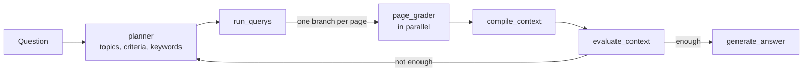

# PDF RAG Agent (index-free)

Answers questions about uploaded PDFs without a vector index: an LLM planner decides what to look for, every page is graded in parallel, and the agent widens its search and retries when the context isn't good enough.

**Stack:** Python · LangGraph (map-reduce with `Send`) · Azure OpenAI · PyPDF2 · Streamlit
**Role:** Lead developer: design and implementation

> Built at a large Brazilian insurer. The company is replaced by the fictional **Acme Seguros**, and every name, document and data point here is fictional. Code, prompts and UI are in Portuguese, written for Brazilian business teams.

## Problem

Teams wanted to ask questions about one-off documents (a report, a manual, a contract) without anyone building and maintaining a search index first. Plain chunk-and-embed retrieval also missed answers spread over several pages.

## What I built



- **Page metadata at upload:** each page gets a summary, main topics and keywords, extracted in parallel.
- **Planner** turns the question into topics, relevance criteria and keywords.
- **Map-reduce grading:** LangGraph fans out one grader per page and gathers the relevant ones.
- **Self-evaluation loop:** if the compiled context can't answer the question, the planner gets feedback and broadens the criteria; a similarity check avoids repeating the same query.
- Documents stay in memory for the session only. `ARQUITETURA.md` describes how to move this design to Azure AI Search for many documents.

## Run it

```bash
python -m venv .venv && .venv\Scripts\activate   # macOS/Linux: source .venv/bin/activate
pip install -r requirements.txt
cp .env.example .env                               # Azure OpenAI
streamlit run streamlit_app.py
```

Works with any PDF.

---
Part of my [AI engineering portfolio](https://github.com/lucasboliveirasipp).
